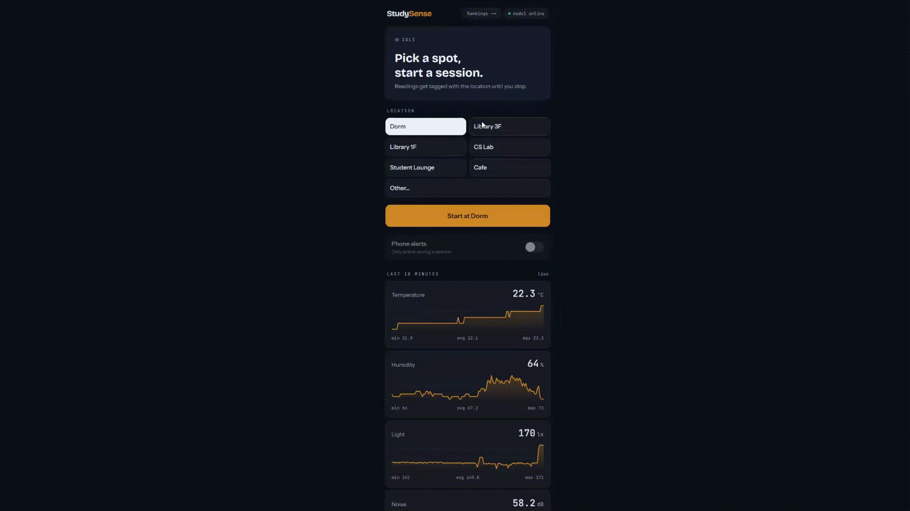
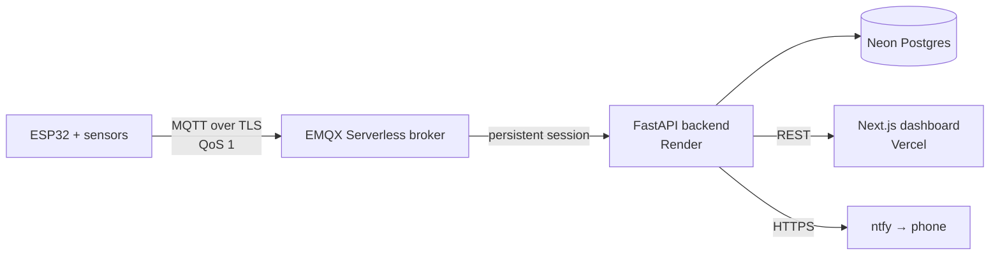
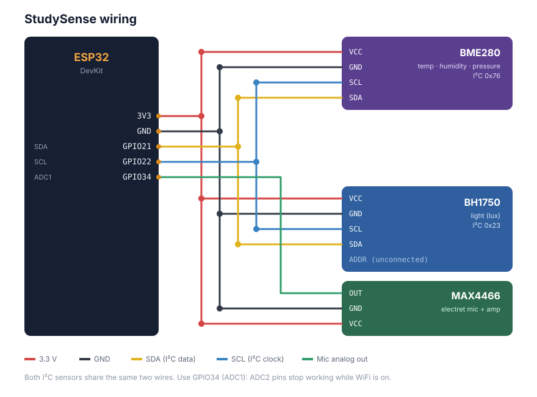
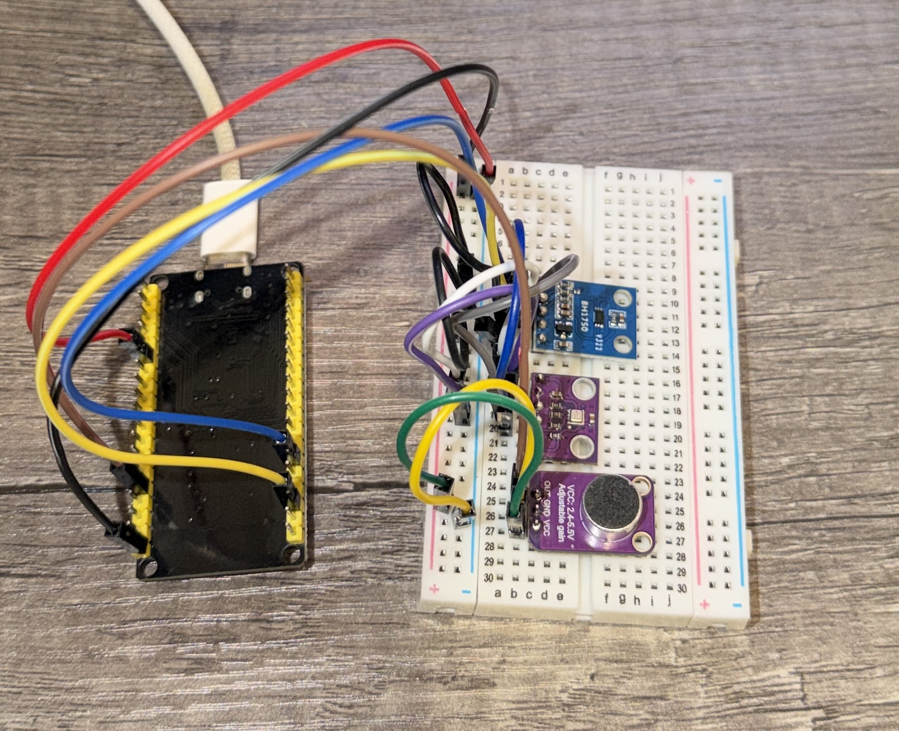

# StudySense

A portable sensor node that measures noise, light, temperature and humidity at study spots, streams the readings to the cloud, ranks the spots using research-backed comfort thresholds, and sends a phone alert when conditions turn bad.


<!--  -->


**Live dashboard:** https://study-sense-lime.vercel.app/

---

## What it does

- **Measures** temperature, humidity, pressure, light (lux) and calibrated noise (dB) every ~5 seconds.
- **Tags readings by study session.** Pick a location on the dashboard, start a session, and every reading is tagged until you stop.
- **Ranks study spots** with a weighted 0–100 score based on published research on noise, lighting, temperature and humidity.
- **Shows live charts** for the current session.
- **Sends phone alerts** (via ntfy) when a rolling average crosses a threshold, and a follow-up when conditions recover. You can switch alerts on and off from the dashboard.

## Architecture



| Layer | Tech |
|---|---|
| Hardware | ESP32 DevKit, BME280 (temp/humidity/pressure), BH1750 (light), MAX4466 electret mic |
| Firmware | Arduino C++, PubSubClient, ArduinoJson, NTP time sync |
| Transport | MQTT over TLS (port 8883) to EMQX Serverless |
| Backend | Python, FastAPI, aiomqtt, SQLModel |
| Database | Neon (serverless Postgres) |
| Frontend | Next.js, TypeScript, Tailwind, hand-drawn SVG charts |
| Alerts | ntfy.sh push notifications |
| Hosting | Render (backend), Vercel (frontend) |

### Data flow

1. The ESP32 samples the mic continuously for 4.8 s, computes the RMS level and converts it to dB, reads the other sensors, and publishes one JSON reading to `spots/node1/reading`. Each reading carries a sequence number and a millisecond timestamp.
2. The device registers a **last will** (`offline`, retained) on `spots/node1/status`, so the broker marks it offline if it drops off.
3. The backend subscribes with **QoS 1** and a **persistent session** (fixed client ID, `clean_session=False`). If the backend restarts, the broker queues readings and delivers them when it reconnects.
4. Each reading is stored in Postgres with a `(device, seq, ts)` unique constraint, so duplicate deliveries during overlapping deploys are rejected.
5. During an active session, a rolling window (~1.5 min) is checked against alert thresholds. Alerts only fire on a **state change** (good → bad, bad → good), with a 2-minute cooldown, so they don't spam you.

## Reliability

| Metric | Result |
|---|---|
| Delivery rate while backend connected | 100 % (no sequence gaps) |
| Backend restart (~45 s downtime) | 0 readings lost: queued by the broker and delivered on reconnect |
| End-to-end latency (device → database) | ~43 ms median, measured on Render |
| Longest continuous run | 22 hours |

Delivery was measured from gaps in the per-reading sequence numbers. Latency is `received_at_ms − ts_ms`, with both clocks NTP-synced. Readings that arrived in a burst after a reconnect were excluded from latency, since they measure queue time, not network time.

## Noise calibration

The MAX4466 outputs a raw voltage, not decibels. To get real dB values, I calibrated it against a phone sound-level meter, with the phone placed right next to the mic:

```
dB = 20 · log10( sqrt(rms² − floor²) ) + C        floor = 62.5, C = 29
```

The `floor` term subtracts the mic's own electrical self-noise, which was measured with the sensor in a closed closet (phone meter read ~30 dB).

| Phone meter | ESP32 RMS | StudySense | Error |
|---|---|---|---|
| 55 dB | 65.7 | 55.1 dB | +0.1 |
| 60 dB | 72.0 | 60.0 dB | 0.0 |
| 65 dB | 87.8 | 64.8 dB | −0.2 |

**Measurable range:** about 50–70 dB. Below ~50 dB, the mic's self-noise drowns out the room, so readings are clamped to 50 dB. That doesn't affect the rankings, because the noise score is already 100 for anything at or below 50 dB.

Debugging notes: the first calibration attempt failed because the mic barely responded to volume (quiet and loud both swung about ±50 ADC counts). Raising the gain on the MAX4466 fixed it. Switching from a 250 ms sampling window to a continuous 4.8 s window made readings much steadier and captures short noises the old window missed.

## Scoring

Each spot gets a 0–100 subscore per factor, computed from its average reading. The total is a weighted average. If a sensor fails, that factor is left out instead of counting as zero.

|   Factor    | Weight | Score = 100 | Falloff              | Alert when      |
|-------------|--------|-------------|----------------------|-----------------|
| Noise       |  40 %  |  ≤ 50 dB    | linear to 0 at 70 dB |     > 65 dB     |
| Light       |  25 %  |  ≥ 500 lx   | linear to 0 at 0 lx  |     < 100 lx    |
| Temperature |  25 %  |  21–23 °C   | −20 per °C outside   | < 19 or > 25 °C |
| Humidity    |  10 %  |  40–60 %    | −2 per % outside     | < 30 or > 60 %  |

## Research basis

The thresholds come from published research and standards. The falloff slopes, the weights and the alert cutoffs are my own design choices, informed by the research.

**Noise.** Office noise at 51 dBA (vs 39 dBA) reduced word recall and motivation (Jahncke et al., 2011), so the score starts dropping above 50 dB. Moderate noise around 70 dB can help creative thinking, but it makes processing harder (Mehta, Zhu & Cheema, 2012), so 70 dB is where the score reaches 0. Noise gets the highest weight because it has the strongest evidence of affecting focused work. The WHO recommends 35 dB in classrooms. StudySense can't measure that low, but it supports "quieter is better."

**Light.** EN 12464-1 sets 500 lx for reading and writing tasks. In a study with 80 students, 500 lx was the most visually comfortable level, and reading was slower at 200 lx (Avcı & Memikoğlu, 2021). Brighter "focus" classroom lighting improved concentration and reading speed (Sleegers et al., 2013; Barkmann et al., 2012). Dorm study halls averaged only 229 lx at night (Isfahan University of Medical Sciences, 2013), so the alert is set lower, at 100 lx, to flag only genuinely dark conditions.

**Temperature.** A meta-analysis of office studies found that performance peaks around 21–22 °C and drops on both sides (Seppänen, Fisk & Lei, 2006).

**Humidity.** 40–60 % minimizes overall health risks (Sterling, Arundel & Sterling, 1985). Below ~40 %, dry eyes and irritated airways become more common, and dry eyes are linked to worse office work (Wolkoff, 2018). Humidity mainly affects comfort rather than thinking directly, so it gets the lowest weight.

**Note on units:** the papers report A-weighted dB (dBA). StudySense measures unweighted dB, calibrated against a dBA phone meter. That's close enough for ranking spots, but it isn't a certified sound-level meter.


## Hardware wiring



|         Sensor          |    Pin    |                 ESP32                 |
|-------------------------|-----------|---------------------------------------|
| BME280 (I²C, addr 0x76) | SDA / SCL |            GPIO 21 / GPIO 22          |
| BH1750 (I²C, addr 0x23) | SDA / SCL |            GPIO 21 / GPIO 22          |
| MAX4466                 | OUT       | GPIO 34 (ADC1, safe to use with WiFi) |
| All sensors | VCC / GND | 3V3 / GND |



## Running it yourself

### Repo layout

```
.
├── backend.py          # FastAPI app + MQTT subscriber
├── requirements.txt
├── esp32/
│   ├── esp32.ino       # firmware
│   └── secrets.h       # not committed
└── web/                # Next.js dashboard
    └── app/
        ├── page.tsx            # session control + live charts
        └── rankings/page.tsx   # ranked spots
```

### Backend

```bash
python -m venv .venv && source .venv/bin/activate
pip install -r requirements.txt
uvicorn backend:app --reload
```

Create a `.env` file (never commit it):

```
DATABASE_URL=postgresql+psycopg://...
MQTT_HOST=...
MQTT_PORT=8883
MQTT_USERNAME=...
MQTT_PASSWORD=...
MQTT_CLIENT_ID=studysense-local
CORS_ORIGINS=http://localhost:3000
NTFY_TOPIC=your-random-topic-name
NTFY_TOKEN=tk_...
```

Use a different `MQTT_CLIENT_ID` locally and in production. Two subscribers with the same ID keep kicking each other off the broker.

### Frontend

```bash
cd web
npm install
NEXT_PUBLIC_API_URL=http://localhost:8000 npm run dev
```

### Firmware

Create `esp32/secrets.h`:

```cpp
#define WIFI_SSID "..."
#define WIFI_PASSWORD "..."
#define MQTT_HOST "..."
#define MQTT_PORT 8883
#define MQTT_USER "..."
#define MQTT_PASSWORD "..."
#define GET_HEALTH "https://your-backend.onrender.com/health"
```

Flash `esp32/esp32.ino` with the Arduino IDE (board: ESP32 Dev Module). The firmware pings `/health` every 10 minutes, because Render's free tier sleeps after 15 minutes without outside traffic.


## References

- Avcı, A. N., & Memikoğlu, İ. (2021). Evaluating effectiveness of LED and OLED lights on user visual comfort and reading performance. *A|Z ITU Journal of the Faculty of Architecture, 18*(2). https://www.az.itu.edu.tr/index.php/jfa/article/view/308
- Barkmann, C., Wessolowski, N., & Schulte-Markwort, M. (2012). Applicability and efficacy of variable light in schools. *Physiology & Behavior, 105*(3), 621–627. https://pubmed.ncbi.nlm.nih.gov/22001491/
- CEN (2021). EN 12464-1: Light and lighting — Lighting of work places — Part 1: Indoor work places.
- Evaluation of lighting intensity in dormitory study halls of Isfahan University of Medical Sciences, Iran (2013). *Journal of Health System Research, 9*(1), 96–103. https://magiran.com/paper/1141984/?lang=en
- Jahncke, H., Hygge, S., Halin, N., Green, A. M., & Dimberg, K. (2011). Open-plan office noise: Cognitive performance and restoration. *Journal of Environmental Psychology, 31*(4), 373–382. https://www.diva-portal.org/smash/record.jsf?pid=diva2:512846
- Mehta, R., Zhu, R., & Cheema, A. (2012). Is noise always bad? Exploring the effects of ambient noise on creative cognition. *Journal of Consumer Research, 39*(4), 784–799. https://academic.oup.com/jcr/article/39/4/784/1795620
- Seppänen, O., Fisk, W. J., & Lei, Q. H. (2006). Effect of temperature on task performance in office environment. Lawrence Berkeley National Laboratory. https://eta-publications.lbl.gov/bibcite/reference/22607
- Sleegers, P. J. C., Moolenaar, N. M., Galetzka, M., Pruyn, A., Sarroukh, B. E., & van der Zande, B. (2013). Lighting affects students' concentration positively: Findings from three Dutch studies. *Lighting Research & Technology, 45*(2), 159–175. https://research.utwente.nl/en/publications/lighting-affects-students-concentration-positively-findings-from-/
- Sterling, E. M., Arundel, A., & Sterling, T. D. (1985). Criteria for human exposure to humidity in occupied buildings. *ASHRAE Transactions, 91*(1).
- Wolkoff, P. (2018). Indoor air humidity, air quality, and health – An overview. *International Journal of Hygiene and Environmental Health, 221*(3), 376–390. https://doi.org/10.1016/j.ijheh.2018.01.015
- World Health Organization (1999). *Guidelines for Community Noise.* https://nonoise.org/library/whonoise/whonoise.htm
